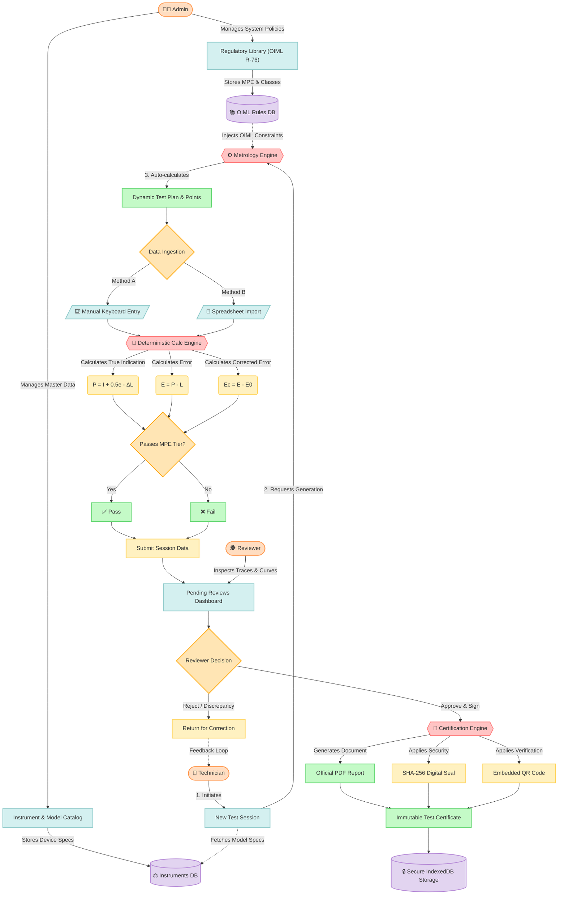

# MetroCert Complex System Architecture & Workflow

Based on your reference flowcharts, this diagram provides a comprehensive, interconnected node-based visual analysis of the MetroCert process flow. It maps the exact relationship between the Actors, Databases, Logic Engines, and Outputs.

You can paste this code into [Mermaid Live Editor](https://mermaid.live/) to export it as a high-resolution PNG or SVG for your presentation.

