# MetroCert (SIH26035) — Detailed System Architecture & Pipeline Specification

**Smart India Hackathon (SIH 2026)**  
**Problem Statement ID:** SIH26035  
**Ministry / Governing Authority:** Ministry of Consumer Affairs, Food & Public Distribution — Department of Consumer Affairs (Legal Metrology Division)  
**Platform Title:** MetroCert / WeighReport — Digital OIML R-76 NAWI Testing, Pattern Approval, Statutory Legal Metrology & Tamper-Evident Report Generation Platform  
**Target Standards & Statutory Framework:**
- **OIML R 76-1:2006 (E):** Non-automatic weighing instruments — Metrological and technical requirements – Tests
- **OIML R 76-2:2007 (E):** Non-automatic weighing instruments — Pattern evaluation report (Formats 1–17)
- **The Legal Metrology Act, 2009 (Act No. 1 of 2010)**
- **The Legal Metrology (General) Rules, 2011 (Seventh Schedule, Heading A)**
- **Legal Metrology (General) Fourth Amendment Rules, 2026 (G.S.R. 568(E))** — Standard weight substitution optimization

---

## 1. High-Level Architectural Topology

```mermaid
flowchart TB
%% ==================== STYLING DEFINITIONS ====================
    classDef clientStyle fill:#0f172a,stroke:#0284c7,stroke-width:2px,color:#f8fafc;
    classDef vercelStyle fill:#0369a1,stroke:#38bdf8,stroke-width:2px,color:#ffffff,stroke-dasharray: 4 4;
    classDef serverStyle fill:#064e3b,stroke:#10b981,stroke-width:2px,color:#ffffff;
    classDef awsStyle fill:#7c2d12,stroke:#f97316,stroke-width:2px,color:#ffffff;
    classDef cloudStorageStyle fill:#78350f,stroke:#f59e0b,stroke-width:2px,color:#ffffff;
    classDef engineStyle fill:#1e1b4b,stroke:#818cf8,stroke-width:3px,color:#ffffff;
    classDef mlStyle fill:#312e81,stroke:#c084fc,stroke-width:2px,color:#ffffff;
    classDef mathStyle fill:#0c4a6e,stroke:#38bdf8,stroke-width:2px,color:#ffffff;
    classDef docStyle fill:#14532d,stroke:#4ade80,stroke-width:2px,color:#ffffff;

%% ==================== TOP LAYER: CLIENTS, ROLES & VERCEL ====================
    subgraph VercelFrontend ["⚡ FRONTEND DEPLOYMENT (VERCEL EDGE NETWORK)"]
        direction TB
        Users(["👤 Users & Stakeholders\n(Testers, Reviewers, Admins, Scale Mfrs)"]):::clientStyle

        subgraph RolesDashboard ["Role-Based Metrology Dashboard (Next.js 14 App Router + React 18 + PWA)"]
            TesterUI["Field Tester Workspace\n• Load Readings Capture\n• Pan Photos & Seals Upload\n• Test Session Submission"]:::clientStyle
            ReviewerUI["QA Reviewer Desk\n• Math Verification Traces\n• MPE Curve Inspection\n• Sign-Off / Rejection"]:::clientStyle
            AdminUI["Legal Metrology Admin\n• Rulepack Governance\n• Standard Weight Master\n• SHA-256 Audit Ledger"]:::clientStyle
        end

        OfflineDB[("Client Offline DB\nDexie.js / IndexedDB\n7 Relational Stores")]:::clientStyle
    end

%% ==================== TOP RIGHT: CLOUDINARY, AWS & DATABASE ====================
    subgraph CloudinaryMaaS ["☁️ CLOUDINARY STORAGE (MaaS - Document & Media as a Service)"]
        direction TB
        ExcelStore["Excel Workbooks (.xlsx) & CSV Batch Stores"]:::cloudStorageStyle
        EvidenceStore["Physical Calibration Evidence\n(Pan Photos, Display Readings, Stamped Seals)"]:::cloudStorageStyle
        DossierStore["Certified Output Dossiers\n(Official OIML R 76-2 PDFs & Formats 1-17 DOCX)"]:::cloudStorageStyle
    end

    subgraph AWSCloud ["🛡️ AWS CLOUD INFRASTRUCTURE"]
        direction TB
        AWS_VPC["AWS VPC & Secure Gateway"]:::awsStyle
        AWS_KMS["AWS KMS & Secrets Manager\n(Cryptographic Key Rotation)"]:::awsStyle
        AWS_Compute["AWS EC2 / ECS / App Runner Containerized Services"]:::awsStyle
        AWS_Monitor["AWS CloudWatch Metrics & Audit Telemetry"]:::awsStyle
    end

    subgraph RelationalDB ["🗄️ DUAL-TIER METROLOGICAL DATABASE"]
        direction TB
        SupabasePG[("Primary Cloud DB\nSupabase PostgreSQL 16\nDedicated 'oiml' Schema + RLS")]:::clientStyle
        SQLiteFallback[("Zero-Downtime Fallback\nLocal SQLite 3 (oiml.db)\nCircuit Breaker Auto-Switch")]:::clientStyle
        AuthSecurity["Security & Auth Gateway\nGoogle OAuth 2.0 + HMAC Tokens\nPBKDF2-HMAC-SHA256 (100k rounds)"]:::clientStyle
    end

%% ==================== MIDDLE: FASTAPI BACKEND SERVER ====================
    subgraph RenderRailwayServer ["🚀 FASTAPI BACKEND SERVER (DEPLOYED ON RENDER OR RAILWAY)"]
        direction TB
        FastAPIGateway["FastAPI 0.110 ASGI Framework (Python 3.12 + Uvicorn)"]:::serverStyle
        
        subgraph ServerPipelines ["Core Server Pipeline Modules"]
            direction LR
            RestRouters["REST API Gateways\n/api/v1/auth, tests, reports,\napplications, dashboard"]:::serverStyle
            OpenPyXLEngine["Batch Data Ingest Pipeline\nOpenPyXL Workbook Streaming\nMulti-Sheet # === SHEET === Parser"]:::serverStyle
            CloudinaryBridge["Cloudinary Storage Connector\nSigned URL Generation &\nBi-directional Asset Fetching"]:::serverStyle
            DocDispatcher["Document & Audit Dispatcher\nReportLab 5.0 + python-docx\nSHA-256 Digest Extraction"]:::serverStyle
        end
    end

%% ==================== BOTTOM: METROLOGY & AI ENGINE ====================
    subgraph CoreEngineContainer ["🔬 METROCERT DETERMINISTIC METROLOGY & AI COMPLIANCE ENGINE"]
        direction TB

        subgraph MLSegment ["🤖 Dual Machine Learning & NLP Pipeline"]
            direction LR
            ML_Suite1["Model Suite 1 (oiml_boundary_model.pkl - 9.6 MB)\n• GradientBoostingRegressor (Continuous MPE Surface)\n• RandomForestClassifier (Compliance Confidence)\n• IsolationForest (Metrological Anomaly & Sensor Jumps)"]:::mlStyle
            ML_Suite2["Model Suite 2 (oiml_test_suggester.pkl - 1.0 MB)\n• MultiOutputClassifier & Decision Trees\n• Instrument Vector: (Class, Max, Min, e, d, n, Power)\n• Automated Statutory Test Selection (T1-T15)"]:::mlStyle
            NLP_LLM["Normative NLP & LLM Metrology Assistant\n• TF-IDF + Cosine Search over 88 Legal Gazette PDFs\n• LLM Regulatory Explanations & Fallback Suggestions\n• Strict Guardrail: LLM Explains, Math Engine Asserts"]:::mlStyle
        end

        subgraph MathSegment ["📐 Deterministic Statutory Mathematical Core (40-Decimal Fixed-Point)"]
            direction LR
            IndicationMath["OIML R 76-1 Error Formulations\n• Indication: P = I + 0.5d - ΔL\n• Raw Error: E = P - L\n• Corrected Error: Ec = E - E0\n• Dynamic MPE Bounds: ±0.5e, ±1.0e, ±1.5e"]:::mathStyle
            TestRunners17["17 Statutory Test Evaluator Suite\n• T1 Weighing · T2 Temp Differential · T3 Eccentricity\n• T4 Discrimination · T5 Repeatability · T6 Creep\n• T7-T9 Stability, Tilting & Tare · T10-T15 Climatic/EMC"]:::mathStyle
            SubstOptimizer["2026 GSR 568(E) Substitution Optimizer\nRepeatability r = Emax - Emin:\n• r ≤ 0.2e ➔ Mandatory Weights: 20% Max\n• 0.2e < r ≤ 0.3e ➔ Mandatory Weights: 33.3% Max\n• r > 0.3e ➔ Mandatory Weights: 50% Max"]:::mathStyle
            ASTEvaluator["Sandboxed AST Rule Evaluator\n• Abstract Syntax Tree (ast.parse) sandboxing\n• Decoupled Rulepacks (oiml-r76, india-lm-2011)\n• Monotonic Dominance: PASSED ⇔ All Tests Pass"]:::mathStyle
        end

        subgraph DocGenSegment ["📑 Two-Pass Document Generation & Cryptographic Verification Layer"]
            direction LR
            ReportLabPDF["ReportLab 5.0 Vector PDF Engine\n• OimlNumberedCanvas (Two-Pass Canvas)\n• Exact 'Page X of Y' Running Header/Footer\n• Official 64-Page OIML R 76-2 Dossier (Formats 1-17)"]:::docStyle
            DocxGenerator["python-docx Microsoft Word Compiler\n• 925-Line Formats 1-17 Generator\n• Styled Tables, Badges & Verification Cells"]:::docStyle
            CryptographicAudit["Cryptographic Non-Repudiation\n• SHA-256 Canonical PDF Fingerprint\n• Blockchain Hash Chain: Hn = SHA-256(Hn-1 ∥ ...)\n• Dynamic QR Code Verification Seal (Verify.tsx)"]:::docStyle
        end
    end

%% ==================== PIPELINE DATA FLOWS ====================
    Users -->|"1. Interacts with Dashboard / PWA"| RolesDashboard
    RolesDashboard <-->|"Offline Cache / Sync"| OfflineDB
    RolesDashboard -->|"2. Batch Excel File (.xlsx) & Photo Upload"| CloudinaryMaaS
    RolesDashboard -->|"3. REST API Requests & Bearer Tokens"| FastAPIGateway

    CloudinaryMaaS <-->|"4. Upload Workbooks / Retrieve Evidence"| CloudinaryBridge
    FastAPIGateway <-->|"Database Transactions & Queries"| RelationalDB
    FastAPIGateway <-->|"Telemetry & Infrastructure Security"| AWSCloud

    FastAPIGateway -->|"5. Ingest Stream to OpenPyXL"| OpenPyXLEngine
    OpenPyXLEngine -->|"6. Structured Data Ingestion"| CoreEngineContainer

    CoreEngineContainer -->|"7. ML Boundary & Anomaly Verification"| MLSegment
    CoreEngineContainer -->|"8. 40-Decimal Exact Calculations"| MathSegment
    CoreEngineContainer -->|"9. Two-Pass Synthesis & SHA-256 Stamping"| DocGenSegment

    DocGenSegment -->|"10. Push Generated Certified Dossiers"| CloudinaryMaaS
    FastAPIGateway -->|"11. Return Live Verdict, MPE Curves & QR Seal"| RolesDashboard
```

---

## 2. Infrastructure & Hosting Architecture

| Subsystem | Target Platform | Technology Stack | Key Responsibilities & Capabilities |
| :--- | :--- | :--- | :--- |
| **Frontend Web App** | **Vercel** | Next.js 14 (App Router), React 18, TypeScript 5.6, Tailwind CSS 3.4 | Edge routing, global CDN caching, zero-config CI/CD, PWA service workers for offline agricultural mandis and weighbridges, Three.js 3D scale visuals, dynamic MPE corridor rendering. |
| **Backend REST API** | **Render / Railway** | Python 3.12, FastAPI 0.110, Uvicorn ASGI | Asynchronous microservices, GZip compression, OpenAPI 3.1 schema delivery, multipart file streaming, background worker execution. |
| **Document Storage (MaaS)** | **Cloudinary** | Cloudinary REST SDK / MaaS APIs | Secure storage for multi-sheet Excel workbooks (`.xlsx`), raw CSV test dumps, photographic pan evidence, calibration seal photos, and official 64-page certified PDF / Word dossiers. |
| **Cloud Services** | **AWS (Amazon Web Services)** | AWS VPC, EC2 / App Runner, KMS, Secrets Manager, CloudWatch | Core cloud infrastructure, virtual private networking, containerized compute execution, cryptographic key rotation, and compliance audit telemetry. |
| **Primary Database** | **Supabase (PostgreSQL 16)** | PostgreSQL 16 (`oiml` schema), Row-Level Security (RLS) | ACID relational data persistence, cascading foreign keys, JSONB storage for dynamic observation tables, and append-only cryptographic audit logs. |
| **Offline Resilience** | **SQLite 3 + Dexie.js** | SQLite 3 (`oiml.db`) + Browser IndexedDB | Seamless offline testing in rural areas; automatic circuit breaker fallback when disconnected from cloud. |

---

## 3. End-to-End Pipeline Workflow

### Step 1: User Ingestion & Media Storage via Cloudinary
1. The **Metrological Field Tester** accesses the role-based dashboard deployed on **Vercel**.
2. When importing test data, the user uploads multi-sheet Excel workbooks (`.xlsx` or `.csv`) and on-pan verification photographs (display readings, stamped seals, nameplates).
3. Raw files and media assets are directly streamed to **Cloudinary MaaS**, securing high-durability storage and generating cryptographically signed URLs.

### Step 2: Data Extraction & Pre-Flight Validation via OpenPyXL
1. The **FastAPI backend** (hosted on **Render / Railway**) retrieves the uploaded workbook from Cloudinary.
2. The `import_data.py` pipeline utilizes `openpyxl` to stream workbook sheets, parsing standardized headers (`# === SHEET: SheetName ===`, `# META: Class, Max, Min, e, d`).
3. An automated pre-flight validator verifies scale step boundaries (1-2-5 sequence), unit normalization (converting $\text{g}, \text{t}, \text{lb}$ to $\text{kg}$), and tare limits prior to running metrological calculations.

### Step 3: Dual Machine Learning & NLP Evaluation
1. **Model Suite 2 (`oiml_test_suggester.pkl`)**:
   - Takes physical attributes ($Class, Max, Min, e, d, n$, Power, Application) and predicts mandatory test requirements ($T1$ through $T15$), preventing redundant testing while guaranteeing statutory coverage.
2. **Model Suite 1 (`oiml_boundary_model.pkl`)**:
   - Evaluates each load step against a continuous MPE surface using `GradientBoostingRegressor`.
   - Computes compliance confidence probability using `RandomForestClassifier`.
   - Flags suspicious laboratory data or sensor failure jumps using `IsolationForest`.
3. **Normative Semantic Search & LLM Assistant**:
   - Uses `TfidfVectorizer` and cosine similarity to index 88 official Legal Metrology gazette PDFs and OIML standards.
   - The LLM assistant suggests remediation guidance and standard citations for failing tests (with a strict rule: LLMs never compute math; deterministic engines assert verdicts).

### Step 4: Deterministic 40-Decimal Metrology Core
1. **Digital Rounding Correction**:
   $$P = I + 0.5d - \Delta L$$
   (Where $I$ is indicated load, $d$ is actual scale division, and $\Delta L$ is the additional weights required to switch to the next increment).
2. **Raw and Zero-Corrected Error**:
   $$E = P - L, \quad E_c = E - E_0$$
3. **Dynamic Piecewise MPE Tolerance Step Functions**:
   $$\text{MPE} = \begin{cases} \pm 0.5e & \text{for } 0 \le m \le m_1 \\ \pm 1.0e & \text{for } m_1 < m \le m_2 \\ \pm 1.5e & \text{for } m_2 < m \le m_3 \end{cases}$$
4. **2026 GSR 568(E) Substitution Weight Optimizer**:
   - Evaluates repeatability dispersion $r = E_{\max} - E_{\min}$:
     - If $r \le 0.2e \implies \text{Standard Weights Required} = 20\% Max$
     - If $0.2e < r \le 0.3e \implies \text{Standard Weights Required} = 33.\bar{3}\% Max$
     - If $r > 0.3e \implies \text{Standard Weights Required} = 50\% Max$
5. **Monotonic Dominance Aggregation**:
   $$\text{Overall Verdict} = \text{PASSED} \iff \forall t \in \{T_1 \dots T_{17}\}, \quad \text{Verdict}(t) \in \{\text{PASSED}, \text{NOT\_APPLICABLE}\}$$

### Step 5: Two-Pass Document Synthesis & Cryptographic Proofs
1. **Server-Side PDF Synthesis (ReportLab 5.0)**:
   - Compiles official 64-page OIML R 76-2 Type Evaluation dossiers using `OimlNumberedCanvas`, accurately calculating total pages ($N$) for running headers (*"Report page X of Y"*).
2. **Microsoft Word Compiler (`python-docx`)**:
   - Programmatically builds fully editable `.docx` files matching Formats 1–17 with styled tables, color-coded verdict badges, and calibration stamps.
3. **Cryptographic Integrity & Dynamic QR Seal**:
   - Computes canonical SHA-256 byte-level digests of generated documents.
   - Appends audit events into an immutable hash chain:
     $$H_n = \text{SHA-256}(H_{n-1} \parallel \text{seq} \parallel \text{timestamp} \parallel \text{user\_id} \parallel \text{action} \parallel \text{data})$$
   - Encodes a high-density QR code carrying the certificate ID and SHA-256 fingerprint for instantaneous field verification by consumer affairs inspectors via `Verify.tsx`.
4. **Certified Dossier Delivery via Cloudinary**:
   - Generated dossiers are published to **Cloudinary MaaS**, providing high-speed download links to the **Role-Based Dashboard** on Vercel.

---

## 4. Visual Diagram Files Available in Workspace

1. **Vector SVG Diagram**: [`docs/METROCERT_SYSTEM_ARCHITECTURE.svg`](file:///c:/Users/RUTVIK%20M/Downloads/sih35/SIH26035/docs/METROCERT_SYSTEM_ARCHITECTURE.svg)
2. **Interactive HTML Viewer**: [`docs/architecture_diagram.html`](file:///c:/Users/RUTVIK%20M/Downloads/sih35/SIH26035/docs/architecture_diagram.html)
3. **Technical Architecture Spec**: [`docs/TECH_STACK_AND_ALGORITHMS.md`](file:///c:/Users/RUTVIK%20M/Downloads/sih35/SIH26035/docs/TECH_STACK_AND_ALGORITHMS.md)
